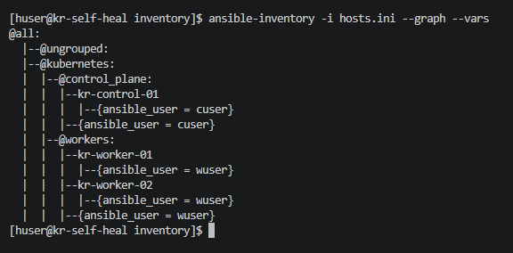
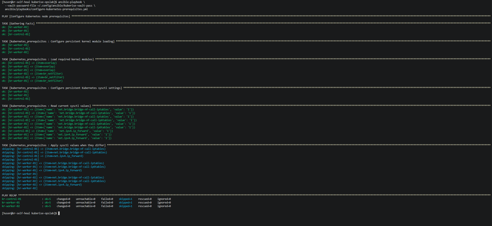
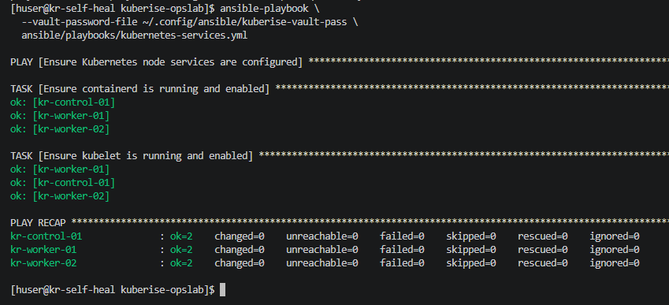
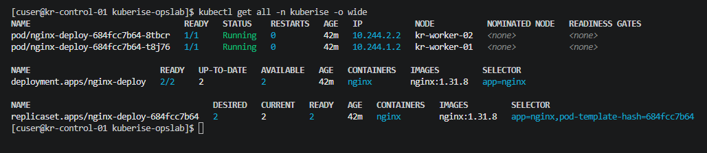
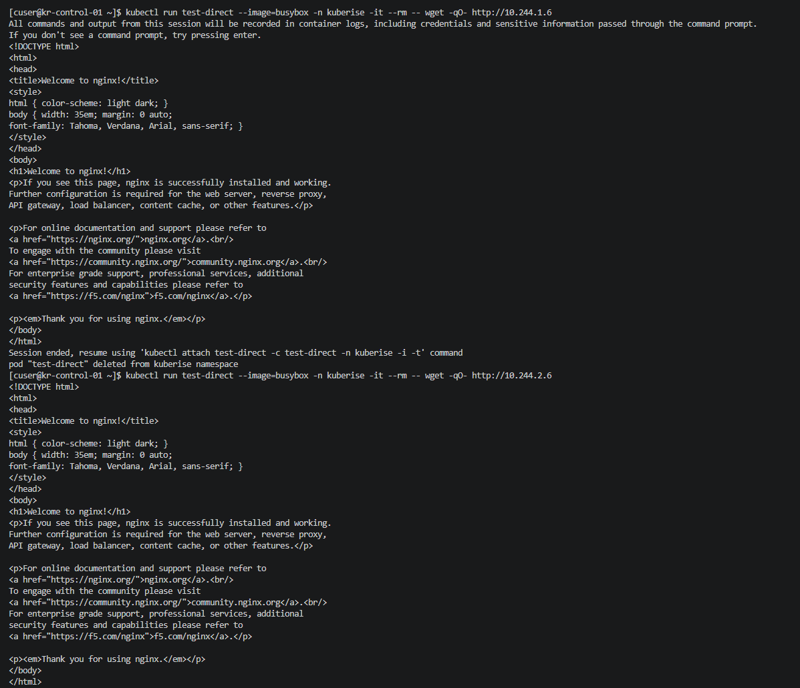

# ☸️ KubeRise OpsLab — Workloads & Ansible Automation (Phase 3)

## 🎯 Objective
Deploy a multi-replica application (Nginx) to the Kubernetes cluster, expose it internally via a Service, and transition node prerequisite configuration from manual Linux commands to repeatable Ansible automation.

## 🖥️ Environment Update
### Automation Control Node
- **Hostname:** `kr-self-heal` (192.168.14.129)
- **Role:** Dedicated Ansible control node, operating outside the Kubernetes cluster to manage configuration drift and automate node setup.

---

## 🛠️ Ansible Automation Setup

To ensure newly built nodes are always configured correctly, we automated the OS prerequisites using Ansible.

### 1. Inventory & Secrets
Configured an inventory (`hosts.ini`) separating `control_plane` and `workers`. Utilized **Ansible Vault** (`vault.yml`) to securely store sudo credentials, ensuring compliance with security best practices.

### 2. Native Modules vs. Jinja2
During development, configuration files were initially templated using Jinja2 (`.j2`). However, this approach added unnecessary complexity for static values. The playbooks were refactored to use **Ansible native modules**, making the code cleaner and completely idempotent.

**Key Playbook Tasks (`configure-kubernetes-prerequisites.yml`):**
- **Kernel Modules:** Used `community.general.modprobe` to load `overlay` and `br_netfilter`.
- **Sysctl Settings:** Used `ansible.posix.sysctl` to apply required Kubernetes networking parameters (`net.bridge.bridge-nf-call-iptables`, `net.ipv4.ip_forward`).
- **Persistence:** Used `ansible.builtin.copy` to write plain-text configuration to `/etc/modules-load.d/` and `/etc/sysctl.d/`, ensuring settings persist across reboots without relying on `.j2` templates.

**Verification:**
Executed the playbook against all three nodes successfully. Because Ansible uses idempotency, it detected that the running kernel state had drifted after a host reboot and automatically reapplied the correct values.

### 3. Kubernetes Services Automation
Created a playbook to ensure core services like `containerd` and `kubelet` are running and enabled.

---

## 🚀 Workload Deployment

### 1. Namespace Creation
Created a dedicated namespace (`kuberise`) to isolate the application from system components.

### 2. Nginx Deployment
Deployed a 2-replica Nginx application using a declarative YAML manifest (`manifests/nginx/nginx-deploy.yml`).
- Configured with `app: nginx` labels for resource matching.
- Kubernetes automatically scheduled one replica on `kr-worker-01` and the other on `kr-worker-02`.

### 3. Service Exposure (ClusterIP)
Created a `ClusterIP` Service (`nginx-service`) to provide a stable internal IP address (`10.99.244.177`) for the Nginx pods. 
- Target Port: `80`
- Selector: `app: nginx`

---

## ✅ Phase 3 Verification

### Pod Status
Both `nginx-deploy` pods are in `Running` state across different worker nodes.

### Service Discovery Test
To verify internal cluster networking and DNS resolution, a temporary BusyBox pod was launched to test connectivity to the Service IP and direct Pod IPs.

---

## 🧠 Key Learnings
- Transitioned from raw Linux commands to declarative Ansible modules.
- Gained a deep understanding of Ansible idempotency and avoiding Jinja2 for static configuration files.
- Practiced Kubernetes resource isolation using Namespaces.
- Demonstrated service discovery and internal cluster DNS routing.

## 🚀 Next Steps
- Troubleshoot cross-node VXLAN networking restrictions imposed by `firewalld`.
- Explore scaling the deployment and rolling updates.
- Introduce ConfigMaps and Secrets.