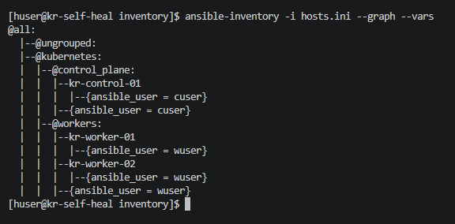
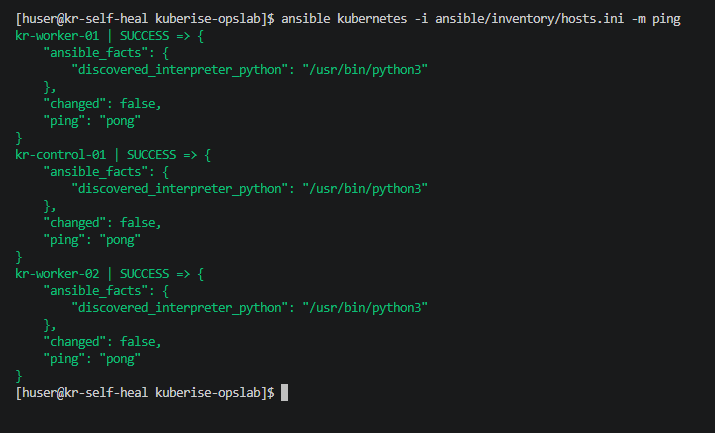

# 🛠️ KubeRise OpsLab — Self-Healing Infrastructure

## 🎯 Objective

Prepare an independent recovery and automation node for the existing Kubernetes cluster. The recovery node will operate separately from the Kubernetes control plane and worker nodes.

## 🖥️ Infrastructure

Hypervisor: VMware Workstation Pro
OS: Rocky Linux 9

### Existing Kubernetes Nodes

| Node | Role | IP Address |
|---|---|---|
| kr-control-01 | Control Plane | 192.168.14.128 |
| kr-worker-01 | Worker | 192.168.14.130 |
| kr-worker-02 | Worker | 192.168.14.131 |

### Recovery Node

| Hostname | Role | IP Address |
|---|---|---|
| kr-self-heal | Recovery and Automation Node | 192.168.14.129 |

## 🌐 Recovery Node Network Configuration

Hostname: `kr-self-heal`
Static IP: `192.168.14.129/24`
Gateway: `192.168.14.2`

The recovery VM was configured with a static IP address to maintain consistent network connectivity.

## 🔐 SSH Access Configuration

Configured passwordless SSH access from the recovery node to all three Kubernetes nodes.

Source: `kr-self-heal`
Remote Nodes:
- `kr-control-01` — 192.168.14.128
- `kr-worker-01` — 192.168.14.130
- `kr-worker-02` — 192.168.14.131

This allows the recovery node to access and remotely manage the Kubernetes infrastructure without requiring an SSH password for each connection.

### Ansible Inventory Setup
Configured the Ansible inventory to group the control plane and worker nodes for automated playbook execution.

### Connectivity Validation
Executed an Ansible ping module across all nodes to verify passwordless SSH access and Python readiness.

## ✅ Current Status

- Recovery VM created successfully.
- Hostname configured.
- Static IP configured.
- Passwordless SSH access established to all three Kubernetes nodes.
- Ansible control node initialized and validated.

The independent recovery node is prepared for the next automation setup tasks.