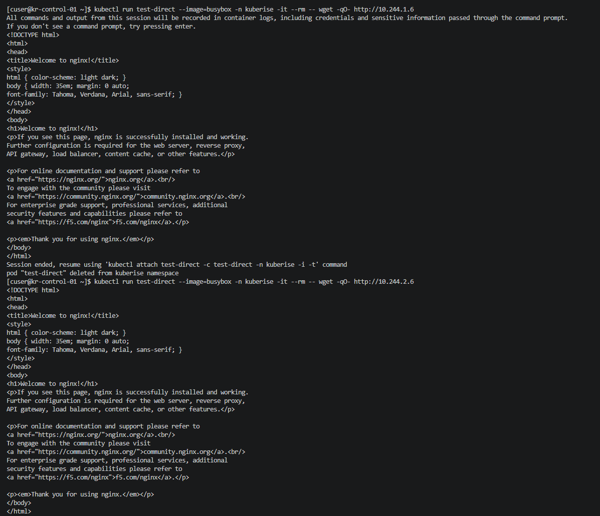

🚑 KubeRise OpsLab — Network Troubleshooting

🎯 Objective
Diagnose and resolve cross-node Pod-to-Pod networking failures (No route to host) encountered during workload deployment.

🚨 The Symptom
- ClusterIP Works: Querying the Nginx Service IP (10.99.244.177) succeeded and returned the Nginx HTML page.
- Direct Pod IP Fails: Querying the Nginx pods directly via their Pod IPs (e.g., 10.244.1.6) resulted in wget: can't connect to remote host: No route to host.

🔍 Diagnosis
1. Firewall Ports Check: Verified that the required Kubernetes ports were open, but noticed 8472/udp (Flannel VXLAN) was only partially configured via Rich Rules.
2. Routing Table Check: ip route confirmed that the flannel.1 interfaces and CNI routes were present and correct on all nodes.
3. Socket Check: ss -ulpn | grep 8472 confirmed Flannel was listening.
4. Root Cause: Because firewalld was active, it was applying default FORWARD chain policies to traffic traversing the bridge interfaces (cni0 and flannel.1). This caused the encapsulated VXLAN packets to be dropped by the kernel before they could reach their destination. (Note: ClusterIP worked because kube-proxy uses SNAT, making the traffic appear to come from the node's physical IP, which bypassed the bridge drop).

🛠️ Resolution
To allow unrestricted internal Kubernetes traffic, the CNI interfaces were explicitly moved to the firewalld trusted zone on all three nodes (kr-control-01, kr-worker-01, kr-worker-02).

# Add CNI interfaces to the trusted zone
sudo firewall-cmd --permanent --zone=trusted --add-interface=cni0
sudo firewall-cmd --permanent --zone=trusted --add-interface=flannel.1

# Reload to apply
sudo firewall-cmd --reload

✅ Verification
After applying the firewall changes, direct Pod-to-Pod communication across nodes was tested successfully.

kubectl run test-direct --image=busybox -n kuberise -it --rm -- wget -qO- http://10.244.1.6

Result: Successfully received the Nginx HTML page from both worker nodes.

🧠 Key Learnings
- Understanding the difference between ClusterIP (SNAT) routing and direct Pod-to-Pod routing.
- How firewalld manages bridge interfaces and the FORWARD chain.
- The importance of trusting cni0 and flannel.1 when running Kubernetes on RHEL-based distributions.

🚧 Current Status
- Cross-node VXLAN networking fully operational.
- Pod-to-Pod communication verified.
- Cluster ready for advanced workload management.